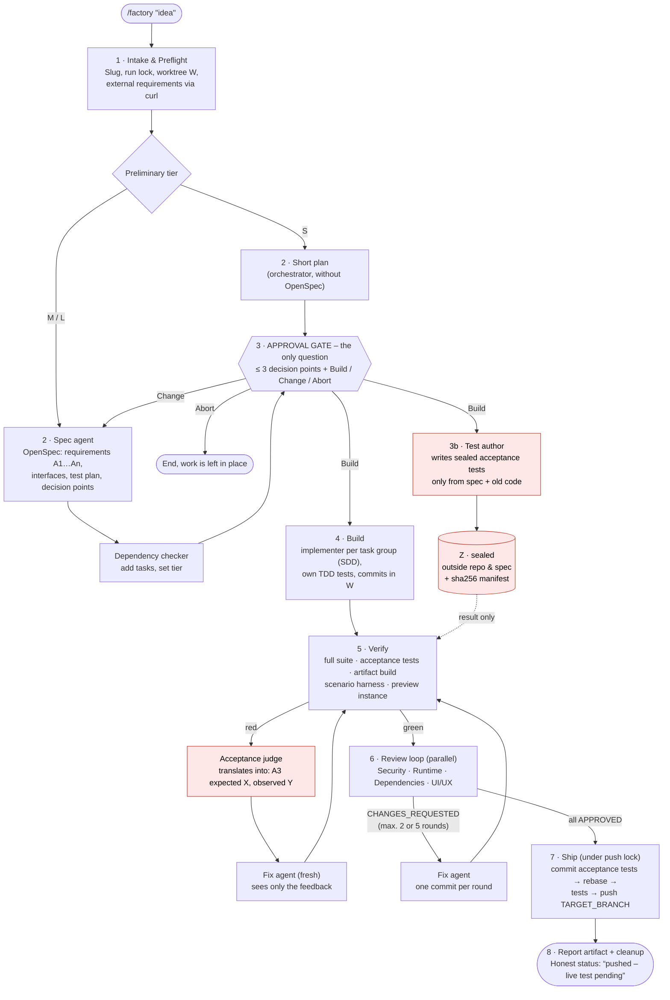
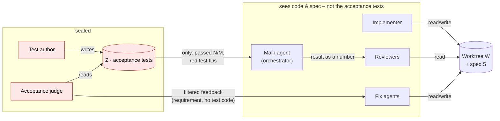
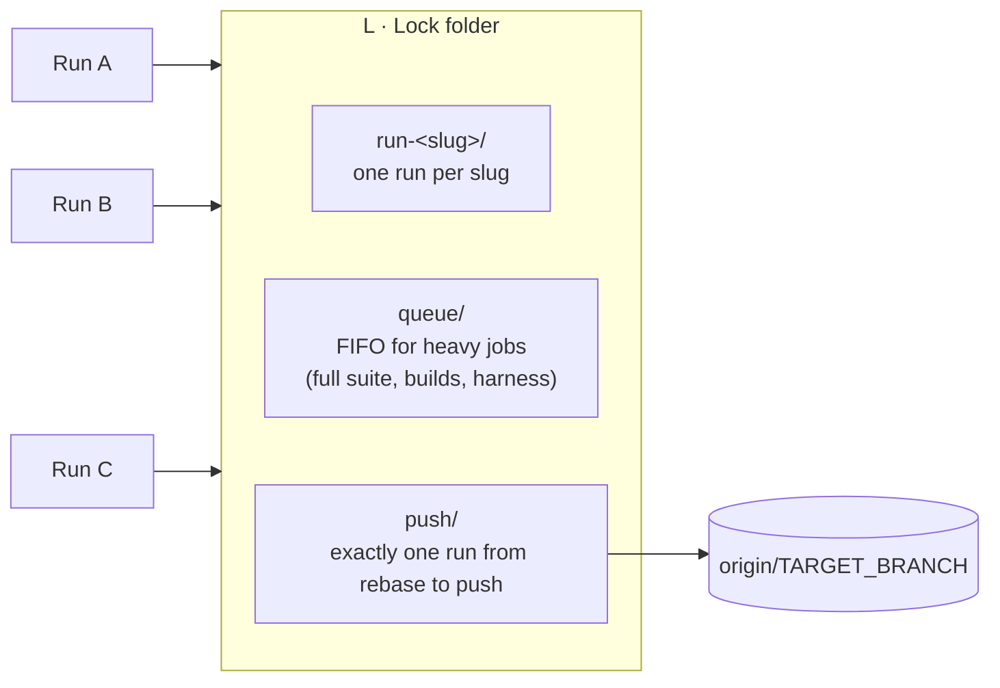

# /factory — Spec-driven Software Factory for Claude Code

A Claude Code skill that turns **a one-line feature idea** into a complete, reviewed commit
on your integration branch:

## Architecture

### How a run works



Aborting is possible from any step from 3b onward (limits for repairs and rounds are in the
log): work is committed as `wip`, the feature branch is saved, and a later invocation
with the same slug resumes.

### Who sees the acceptance tests?



### Parallel runs



All locks use `mkdir` (atomic) and a heartbeat via `touch`; orphaned locks are cleaned up by
the next run.

Origin: developed and refined in the MeetingAgent project over ~10 real runs; this is
the project-neutral version. Everything project-specific lives in **one** file,
`factory.config.md`.

## What makes it different

- **Exactly one approval gate.** Instead of nodding through 20 assumptions, the gate asks at most 3 "decision points" —
  decisions that significantly change the result, architecture or effort — with
  ASCII sketches for visual matters. After that, everything runs through without further questions.
- **Sealed acceptance tests.** A dedicated test author writes acceptance tests from the spec into
  a folder outside the repo and the spec. **The agent implementing the task does not know
  them** — neither location nor content — and so can neither tailor its work to them nor weaken them.
  The orchestrator and reviewers also see only the result. On red, the fix agent gets only
  filtered feedback ("Requirement A3: expected X, observed Y"), never the test code.
  Hash manifest against tampering; changes to test infrastructure are a security finding.
  Once acceptance passes, the tests are committed as regression tests.
  Details: `SKILL.md`, section "Acceptance tests" (including an honest limit of the isolation).
- **Tiers S/M/L.** A CSS change does not get a 40-minute review. The tier is estimated
  up front, shown at the approval gate, and automatically raised based on the real diff, never lowered.
- **Review loop until everyone is satisfied** — with finding IDs, round limits, clear
  abort rules and a conflict order.
- **Parallel runs.** Several runs in several sessions at once: run lock,
  push lock, FIFO queue for heavy jobs (`queue.sh`) with heartbeat.
- **Honest status.** Green tests ≠ works live: for critical paths the status is
  "pushed – live test pending", with a checklist.
- **Resumable.** `$S/factory-log.md` is the single source of truth; invoking again with
  the same slug resumes.

## Files

| File | Content |
|---|---|
| `SKILL.md` | The procedure (steps 1–8, acceptance tests, parallel runs, abort, follow-up) |
| `reviewers.md` | Checklists, responsibilities and response format of the reviewers |
| `queue.sh` | Queue for heavy jobs (generic, usable unchanged) |
| `factory.config.example.md` | Template for the project adapter — all slots |
| `examples/meetingagent.factory.config.md` | Filled-in example from the original project (contains internal names/URLs — remove before publishing the repo) |

## Requirements

Required:
- Claude Code with subagents (`Agent` tool) and `AskUserQuestion`.
- [OpenSpec](https://github.com/Fission-AI/OpenSpec) CLI (`openspec`) and the OpenSpec skills
  in the session folder (`openspec init` creates `openspec-propose`, `openspec-update-change`,
  `opsx:archive` …).
- Superpowers plugin: `superpowers:subagent-driven-development`,
  `superpowers:systematic-debugging`.
- Skill `security-review` (built into Claude Code).
- `git` with worktrees, `bash` (Git Bash on Windows), `curl`.

Optional:
- Docker (test runs in containers, preview instance, artifact builds).
- UI skills for the UI/UX reviewer: `taste-skill`, `ui-ux-pro-max`, `design:*`.
- A headless screenshot tool that can run in parallel (e.g. a small
  Puppeteer/CDP script).
- A scenario harness/simulator for end-to-end tests of the shipped artifact.

## Installing in a project

1. Put the skill folder into the project (or globally):
   ```bash
   git clone git@github.com:Sighte/factory-skill.git <repo>/.claude/skills/factory
   # or as a submodule, so updates come along
   ```
   If the session starts not in the repo but in a parent folder (worktrees as
   siblings), create `.claude/skills/factory` there as a link to the repo folder.
2. Copy `factory.config.example.md` to `$R/factory.config.md` (session folder,
   **outside** the repo — the config names the location and runner of the sealed tests, and
   implementers read the worktree) and fill in **every** slot. Fastest: ask Claude in a session "to fill in the factory.config.md for
   this repo based on the template" — and check the result yourself (branches,
   protected jobs, test commands).
3. Add to the project rules (`CLAUDE.md`):
   > Exception `/factory`: after the approval gate, green tests, passed acceptance and
   > review loop, pushes directly to `<TARGET_BRANCH>`, without an MR.

   Otherwise the reviewers report this as a finding.
4. Add `.superpowers/` to `.gitignore` (working folder of the subagents).
5. Do a first run with a small idea (tier S) and read `factory-log.md`.

## Usage

```
/factory "News button in the header, shows the last 5 changes"
```

At the approval gate: answer the decision points, then **Build** / **Change** / **Abort**. After that the
run proceeds on its own until the push and ends with a report artifact (status, acceptance per
requirement, review log, before/after screenshots, pending live tests).

## Customizing

- More/different reviewers: section in `reviewers.md` + row in the responsibilities table +
  slot in the config.
- Stricter acceptance isolation: `SKILL.md`, acceptance tests rule 9 (separate host/service for `Z`).
- Project lessons belong in the config (`*_EXTRA`, `HARNESS_NOTES`), not in `SKILL.md` —
  that way the skill stays the same across projects.
