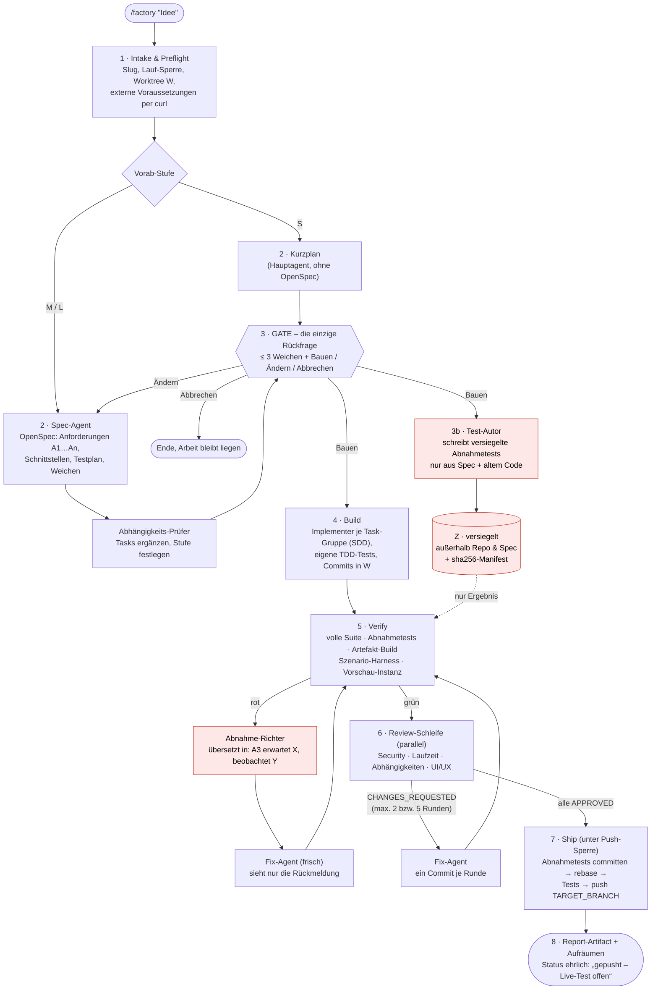
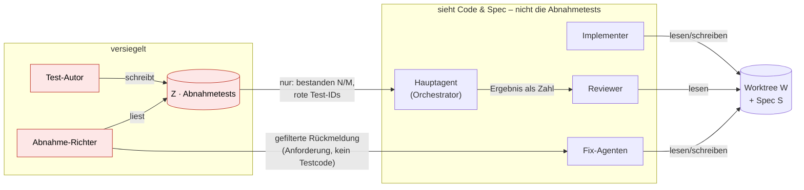
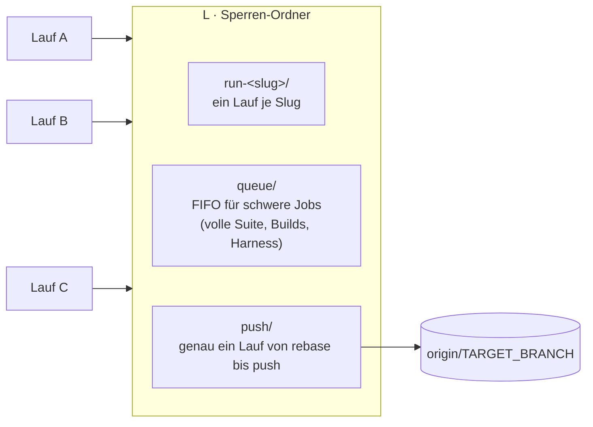

# /factory — Spec-driven Software Factory für Claude Code

Ein Claude-Code-Skill, der aus **einer Zeile Feature-Idee** einen kompletten, geprüften Commit
auf deinem Integrations-Branch macht:

## Architektur

### Ablauf eines Laufs



Abbruch ist aus jedem Schritt ab 3b möglich (Grenzen für Reparaturen und Runden stehen im
Protokoll): Arbeit wird als `wip` committet, Feature-Branch gesichert, ein späterer Aufruf
mit demselben Slug setzt fort.

### Wer sieht die Abnahmetests?



### Parallelbetrieb



Alle Sperren mit `mkdir` (atomar) und Herzschlag per `touch`; verwaiste Sperren räumt der
nächste Lauf weg.

Herkunft: im MeetingAgent-Projekt über ~10 echte Läufe entstanden und nachgeschärft; dies ist
die projektneutrale Fassung. Alles Projektspezifische steckt in **einer** Datei,
`factory.config.md`.

## Was sie besonders macht

- **Genau ein Gate.** Statt 20 Annahmen abzunicken, fragt das Gate höchstens 3 „Weichen“ —
  Entscheidungen, die Ergebnis, Architektur oder Aufwand deutlich ändern — bei Optik mit
  ASCII-Skizzen. Danach läuft alles ohne Rückfrage durch.
- **Versiegelte Abnahmetests.** Ein eigener Test-Autor schreibt aus der Spec Abnahmetests in
  einen Ordner außerhalb von Repo und Spec. **Der Agent, der die Aufgabe umsetzt, kennt sie
  nicht** — weder Ort noch Inhalt — und kann sie daher weder gezielt erfüllen noch abschwächen.
  Auch Orchestrator und Reviewer sehen nur das Ergebnis. Bei Rot bekommt der Fix-Agent nur
  eine gefilterte Rückmeldung („Anforderung A3: erwartet X, beobachtet Y“), nie den Testcode.
  Hash-Manifest gegen Manipulation; Änderungen an Test-Infrastruktur sind ein Security-Befund.
  Nach bestandener Abnahme werden die Tests als Regressionstests committet.
  Details: `SKILL.md`, Abschnitt „Abnahmetests“ (inkl. ehrlicher Grenze der Isolation).
- **Stufen S/M/L.** Eine CSS-Änderung bekommt keinen 40-Minuten-Review. Die Stufe wird vorab
  geschätzt, am Gate angezeigt, und am echten Diff automatisch hoch-, nie heruntergestuft.
- **Review-Schleife bis alle zufrieden sind** — mit Befund-IDs, Rundengrenzen, klaren
  Abbruchregeln und Konfliktreihenfolge.
- **Parallelbetrieb.** Mehrere Läufe in mehreren Sessions gleichzeitig: Lauf-Sperre,
  Push-Sperre, FIFO-Warteschlange für schwere Jobs (`queue.sh`) mit Herzschlag.
- **Ehrlicher Status.** Grüne Tests ≠ funktioniert live: bei kritischen Pfaden heißt der Status
  „gepusht – Live-Test offen“, mit Checkliste.
- **Fortsetzbar.** `$S/factory-log.md` ist die einzige Wahrheit; ein erneuter Aufruf mit
  demselben Slug setzt fort.

## Dateien

| Datei | Inhalt |
|---|---|
| `SKILL.md` | Der Ablauf (Schritte 1–8, Abnahmetests, Parallelbetrieb, Abbruch, Nachtrag) |
| `reviewers.md` | Prüflisten, Zuständigkeit und Antwortformat der Reviewer |
| `queue.sh` | Warteschlange für schwere Jobs (generisch, unverändert nutzbar) |
| `factory.config.example.md` | Vorlage für den Projekt-Adapter — alle Slots |
| `examples/meetingagent.factory.config.md` | Ausgefülltes Beispiel aus dem Ursprungsprojekt (enthält interne Namen/URLs — vor einer Veröffentlichung des Repos entfernen) |

## Voraussetzungen

Pflicht:
- Claude Code mit Subagents (`Agent`-Tool) und `AskUserQuestion`.
- [OpenSpec](https://github.com/Fission-AI/OpenSpec) CLI (`openspec`) und die OpenSpec-Skills
  im Session-Ordner (`openspec init` legt `openspec-propose`, `openspec-update-change`,
  `opsx:archive` … an).
- Superpowers-Plugin: `superpowers:subagent-driven-development`,
  `superpowers:systematic-debugging`.
- Skill `security-review` (in Claude Code eingebaut).
- `git` mit Worktrees, `bash` (unter Windows Git-Bash), `curl`.

Optional:
- Docker (Testläufe in Containern, Vorschau-Instanz, Artefakt-Builds).
- UI-Skills für den UI/UX-Reviewer: `taste-skill`, `ui-ux-pro-max`, `design:*`.
- Ein Headless-Screenshot-Werkzeug, das parallel laufen kann (z. B. ein kleines
  Puppeteer/CDP-Skript).
- Eine Szenario-Harness/Simulator für End-to-End-Tests des ausgelieferten Artefakts.

## Installation in einem Projekt

1. Skill-Ordner ins Projekt legen (oder global):
   ```bash
   git clone git@github.com:Sighte/factory-skill.git <repo>/.claude/skills/factory
   # oder als Submodule, damit Updates mitkommen
   ```
   Startet die Session nicht im Repo, sondern in einem Oberordner (Worktrees als
   Geschwister), dort `.claude/skills/factory` als Verknüpfung auf den Repo-Ordner anlegen.
2. `factory.config.example.md` nach `$R/factory.config.md` kopieren (Session-Ordner,
   **außerhalb** des Repos — die Config nennt Ort und Runner der versiegelten Tests, und
   Implementer lesen den Worktree) und **jeden** Slot füllen. Am schnellsten: Claude in einer Session bitten, „die factory.config.md für
   dieses Repo anhand der Vorlage auszufüllen“ — und das Ergebnis selbst prüfen (Branches,
   geschützte Jobs, Testbefehle).
3. In die Projektregeln (`CLAUDE.md`) aufnehmen:
   > Ausnahme `/factory`: pusht nach Gate, grünen Tests, bestandener Abnahme und
   > Review-Schleife direkt nach `<TARGET_BRANCH>`, ohne MR.

   Sonst melden die Reviewer das als Befund.
4. `.superpowers/` in `.gitignore` (Arbeitsordner der Subagents).
5. Ersten Lauf mit einer kleinen Idee machen (Stufe S) und `factory-log.md` lesen.

## Aufruf

```
/factory "Neuigkeiten-Knopf im Kopf, zeigt die letzten 5 Änderungen"
```

Am Gate: Weichen beantworten, dann **Bauen** / **Ändern** / **Abbrechen**. Danach läuft der
Lauf allein bis zum Push und endet mit einem Report-Artifact (Status, Abnahme je
Anforderung, Review-Protokoll, Screenshots vorher/nachher, offene Live-Tests).

## Anpassen

- Mehr/andere Reviewer: Abschnitt in `reviewers.md` + Zeile in der Zuständigkeitstabelle +
  Slot in der Config.
- Strengere Abnahme-Isolation: `SKILL.md`, Abnahmetests Regel 9 (eigener Host/Dienst für `Z`).
- Projekt-Lehren gehören in die Config (`*_EXTRA`, `HARNESS_NOTES`), nicht in `SKILL.md` —
  so bleibt der Skill zwischen Projekten gleich.
